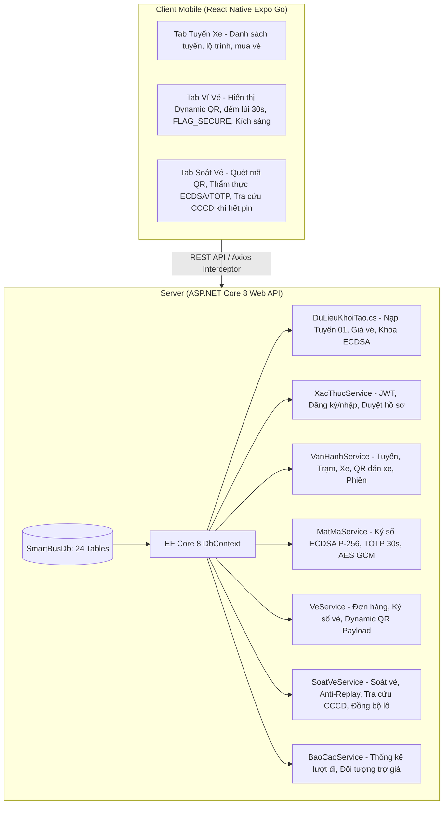

# BÁO CÁO TRIỂN KHAI HOÀN THIỆN CÁC PHÂN HỆ HỆ THỐNG SMARTBUS

> **Dự án:** Xây dựng hệ thống xác thực và quản lý lượt đi xe buýt sử dụng mã QR động, chữ ký số và cơ chế xác thực ngoại tuyến  
> **Sinh viên thực hiện:** Nguyễn Phước Thịnh (1150070040)  
> **Thời điểm cập nhật:** 25/10/2026  
> **Trạng thái:** Toàn bộ Backend (.NET 8) và Frontend (React Native Expo) đã được kết nối CSDL `SmartBusDb` và biên dịch thành công 0 Lỗi.

---

## 1. Tổng quan Kiến Trúc Đã Triển Khai

Hệ thống đã triển khai đầy đủ 7 giai đoạn chức năng bám sát 24 bảng CSDL trong `SmartBusDb`:



---

## 2. Chi Tiết Các Phân Hệ Trên Server (.NET 8)

Mọi Controller và Service đều tuân thủ nghiêm ngặt các quy tắc:
* **Tên hàm/biến:** Tiếng Việt không dấu (`layDanhSach`, `luuTuyenXe`, `xacThucVe`...).
* **Không dùng:** `/// <summary>` và `#region`.
* **Cấu trúc:** Interface nằm trên, Service nằm dưới trong cùng 1 file `.cs`.
* **Giao thức:** Chỉ dùng `[HttpGet]` và `[HttpPost]`.
* **Phản hồi chuẩn:** `Ok(KetQuaPhanHoi.ThanhCong(...))` đúng định dạng `{ data, statusCode, message }`.
* **Hàm lưu:** `id == 0` là Thêm mới, `id != 0` là Cập nhật.

### Danh Sách Controller & Endpoint:

1. **`NguoiDungController` (`api/NguoiDung/`):**
   * `[HttpGet("lay-danh-sach")]`: Danh sách tài khoản người dùng trong hệ thống.
   * `[HttpGet("lay-chi-tiet")]`: Chi tiết người dùng theo ID.
   * `[HttpPost("luu-nguoi-dung")]`: Thêm/sửa người dùng (`id == 0` thêm, `id != 0` sửa).
   * `[HttpPost("khoa-tai-khoan")]`: Khóa/mở khóa tài khoản.

2. **`XacThucController` (`api/XacThuc/`):**
   * `[HttpPost("dang-nhap")]`: Đăng nhập bằng Email/SĐT/CCCD, trả về JWT Token.
   * `[HttpPost("dang-ky")]`: Đăng ký tài khoản hành khách.
   * `[HttpGet("thong-tin-ca-nhan")]`: Lấy thông tin cá nhân và nhóm ưu tiên đã duyệt.
   * `[HttpPost("nop-ho-so-uu-tien")]`: Nộp minh chứng giảm giá (HSSV / Người cao tuổi).
   * `[HttpGet("danh-sach-ho-so-cho-duyet")]`: Quản trị viên xem hồ sơ chờ duyệt.
   * `[HttpPost("duyet-ho-so-uu-tien")]`: Phê duyệt hoặc từ chối hồ sơ ưu tiên.

3. **`VanHanhController` (`api/VanHanh/`):**
   * `[HttpGet("danh-sach-tuyen")]`: Danh sách tuyến xe buýt đang chạy.
   * `[HttpGet("chi-tiet-tuyen")]`: Chi tiết lộ trình đi/về và thứ tự trạm dừng.
   * `[HttpPost("luu-tuyen-xe")]`: Thêm/sửa tuyến xe buýt.
   * `[HttpGet("danh-sach-tram-dung")]`: Danh sách trạm dừng (theo tuyến hoặc toàn mạng).
   * `[HttpPost("luu-tram-dung")]`: Thêm/sửa trạm dừng xe buýt.
   * `[HttpGet("danh-sach-xe-buyt")]`: Danh sách xe buýt và mã QR dán cố định trên xe.
   * `[HttpPost("luu-xe-buyt")]`: Thêm/sửa thông tin xe buýt.
   * `[HttpGet("quet-qr-dan-xe")]`: Nhận diện xe và tuyến tức thì khi hành khách quét mã QR dán trên cửa xe.
   * `[HttpPost("bat-dau-phien-soat-ve")]`: Khởi tạo phiên soát vé cho nhân viên trên chuyến.
   * `[HttpPost("ket-thuc-phien-soat-ve")]`: Kết thúc phiên soát vé.

4. **`VeController` (`api/Ve/`):**
   * `[HttpGet("danh-sach-bieu-gia")]`: Biểu giá vé theo tuyến, nhóm đối tượng (vé lượt, vé tháng).
   * `[HttpPost("tao-don-hang")]`: Tạo đơn mua vé (tự động nhận diện miễn phí 100% nếu là đối tượng ưu tiên hợp lệ).
   * `[HttpPost("thanh-toan-don-hang")]`: Xử lý thanh toán và tự động kích hoạt Ký số ECDSA + cấp vé vào ví.
   * `[HttpGet("vi-ve-cua-toi")]`: Lấy danh sách vé điện tử còn hạn của hành khách kèm chu kỳ đếm lùi TOTP.
   * `[HttpGet("chi-tiet-qr-dong")]`: Trả về chuỗi Dynamic QR mã hóa thời gian thực.
   * `[HttpPost("khoa-ve")]`: Khóa hoặc thu hồi vé vi phạm và lưu vết vào `NhatKyThuHoiVe`.

5. **`SoatVeController` (`api/SoatVe/`):**
   * `[HttpGet("goi-du-lieu-ngoai-tuyen")]`: Tải Public Key và danh sách vé bị khóa về máy soát vé để thẩm thực Offline khi mất mạng.
   * `[HttpPost("xac-thuc-ve")]`: Quét kiểm tra chữ ký ECDSA, kiểm tra mã TOTP, phát hiện vé dùng lại (Anti-Replay) hoặc chụp ảnh chia sẻ.
   * `[HttpPost("tra-cuu-khan-cap")]`: Tra cứu khẩn cấp qua CCCD hoặc SĐT khi điện thoại hành khách hết pin.
   * `[HttpPost("dong-bo-lo")]`: Đồng bộ lô dữ liệu ngoại tuyến (`LoDongBo`) khi xe có mạng trở lại.
   * `[HttpGet("canh-bao-gian-lan")]`: Danh sách các trường hợp vé quét trùng lặp, nghi vấn gian lận.

6. **`BaoCaoController` (`api/BaoCao/`):**
   * `[HttpGet("luot-di-theo-tuyen")]`: Thống kê số lượt đi thực tế theo từng tuyến xe.
   * `[HttpGet("theo-nhom-doi-tuong")]`: Thống kê tỷ lệ đối tượng ưu tiên phục vụ hồ sơ quyết toán trợ giá với Sở GTVT.
   * `[HttpGet("doanh-thu")]`: Tổng doanh thu bán vé và kinh phí trợ giá đã chi trả.

---

## 3. Kiến Trúc Mật Mã Học & Xác Thực Ngoại Tuyến

1. **Chữ ký số bất đối xứng ECDSA P-256:**
   * Máy chủ Server giữ Private Key trong Key Store an toàn.
   * Dữ liệu vé chuẩn hóa (Mã vé, chủ vé, phạm vi tuyến, loại vé, nhóm đối tượng, thời hạn) được ký số tạo ra chữ ký điện tử chuẩn P1363 (64 bytes).
   * Thiết bị soát vé (Terminal/Điện thoại nhân viên) chỉ cần giữ Public Key trong SQLite là có thể thẩm thực tính toàn vẹn của vé **ngay cả khi ngắt kết nối mạng hoàn toàn** trong thời gian < 0.1 giây.

2. **Mã một lần theo thời gian thực TOTP (RFC 6238) + HMAC-SHA256:**
   * Mỗi vé phát hành được cấp một chuỗi bí mật ngẫu nhiên 32 bytes (được mã hóa AES bảo vệ trong CSDL).
   * Điện thoại hành khách sinh mã TOTP 8 chữ số đổi mới sau mỗi chu kỳ 30 giây.
   * Cơ chế chống phát lại (Anti-Replay): Nếu hành khách chụp ảnh màn hình chia sẻ cho người khác, mã QR cũ sẽ bị máy soát vé từ chối ngay lập tức khi bước thời gian trôi qua.

3. **Cấu trúc chuỗi Payload QR Động:**
   ```
   SMARTBUS:v1:{maVe}:{maTotpHienTai}:{chuKyECDSA_Base64}
   ```

4. **Bảo mật phía Client Mobile:**
   * Tự động kích hoạt cờ `FLAG_SECURE` (`expo-screen-capture`): Chặn toàn bộ thao tác chụp ảnh màn hình hoặc quay video khi màn hình hiển thị vé QR.
   * Tự động tăng độ sáng màn hình (`expo-brightness`) lên 100% giúp camera máy soát vé đọc cực nhanh trong mọi điều kiện ánh sáng.

---

## 4. Dữ Liệu Khởi Tạo Cơ Sở (Seed Data Đã Nạp)

Hệ thống đã tự động nạp dữ liệu cơ sở vào CSDL `SmartBusDb`:
* **Tài khoản:** 
  * Quản trị viên: `admin@smartbus.vn` (Mật khẩu: `123456`)
  * Nhân viên soát vé: `soatve01@smartbus.vn` (Mật khẩu: `123456`)
  * Hành khách mẫu: `thinh@smartbus.vn` (Mật khẩu: `123456`, CCCD: `079000000003`)
* **Tuyến xe buýt:** Tuyến 01 (Bến Thành - BX Chợ Lớn) và Tuyến 150 (BX Chợ Lớn - Tân Vạn).
* **Trạm dừng:** Bến Thành (BT01), Trường ĐH Tài Nguyên và Môi Trường (DH01), Bến xe Chợ Lớn (CL01).
* **Xe buýt:** Xe `51B-123.45` (Mã QR dán xe: `11111111-1111-1111-1111-111111111111`).
* **Biểu giá vé:** Vé lượt phổ thông 7.000đ, Vé lượt HSSV 3.000đ, Vé lượt Người cao tuổi 0đ, Vé tháng 200.000đ.
* **Khóa ký số:** Cặp khóa `ECDSA-SMARTBUS-2026-KEY01` (ECDSA P-256 SHA-256).

---

## 5. Hướng Dẫn Chạy & Kiểm Thử Toàn Diện

### Khởi động Server (.NET 8):
```powershell
cd "d:\mon hoc\DoAnTN\Thinh\Project\Server"
dotnet run --urls "http://localhost:5000"
```
* Swagger UI: Mở trình duyệt truy cập `http://localhost:5000/swagger` để xem và test toàn bộ 25+ endpoint.

### Khởi động Client (React Native Expo):
```powershell
cd "d:\mon hoc\DoAnTN\Thinh\Project\Client"
npm run start:tunnel
```
* Mở app **Expo Go** trên điện thoại Android/iOS và quét mã QR terminal.
* Ứng dụng cung cấp 3 Tab hoàn chỉnh:
  * **Tab Tuyến Xe:** Xem danh mục tuyến, xem bảng giá và bấm mua vé.
  * **Tab Ví Vé:** Mở vé điện tử, xem Dynamic QR đổi mã mỗi 30 giây, thanh đếm lùi thời gian thực.
  * **Tab Soát Vé:** Thử nghiệm quét vé, kiểm tra tính hợp lệ và tra cứu khẩn cấp qua CCCD khi điện thoại khách hết pin.
