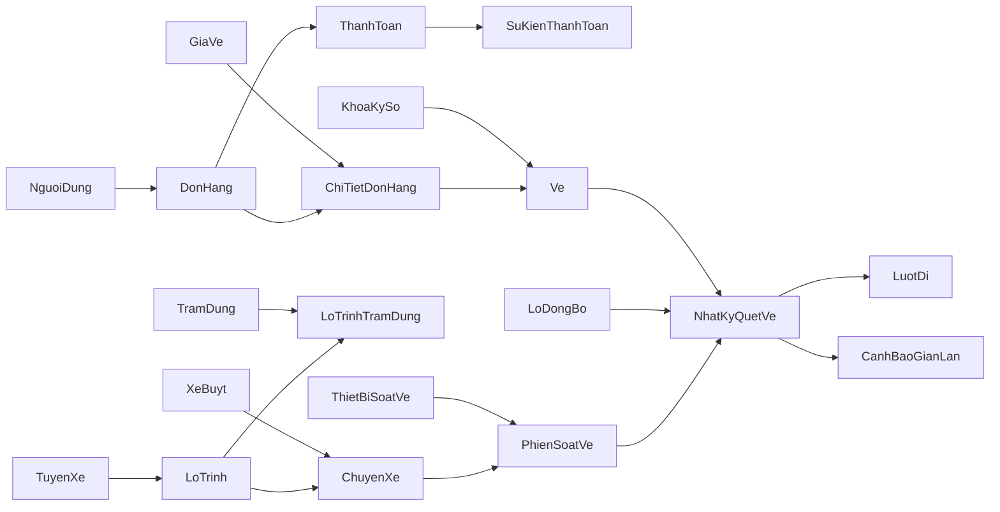

# Cấu trúc DB đề xuất cho SmartBus

Dựa trên `antigravity_khoitaocautruc.md` và đề cương, DB dùng SQL Server 2019 trở lên, tên `SmartBusDb` khớp cấu hình backend hiện tại. Đây là thiết kế đề xuất để triển khai; các bảng chưa tự kết nối vào service đang dùng danh sách tạm.

Script: [01_khoi_tao_SmartBusDb.sql](../Server/Database/01_khoi_tao_SmartBusDb.sql).

## 1. Danh sách 24 bảng

| Nhóm | Bảng | Mục đích |
|---|---|---|
| Người dùng | `NhomDoiTuong` | Phổ thông, học sinh/sinh viên, người cao tuổi; không gắn cứng chính sách miễn phí vào nhóm. |
| Người dùng | `NguoiDung` | Tài khoản, thông tin liên hệ, CCCD và vai trò; giữ `id`, `hoTen`, `soDienThoai`, `email`, `cccd`, `vaiTro`, `trangThai` tương ứng DTO hiện có. |
| Người dùng | `HoSoUuTien` | Minh chứng, người duyệt, trạng thái và thời hạn hưởng chính sách; giữ lịch sử hồ sơ. |
| Vận hành | `TuyenXe` | Tuyến và khung giờ hoạt động. |
| Vận hành | `TramDung` | Trạm và tọa độ. |
| Vận hành | `LoTrinh` | Chiều đi/về và phiên bản lộ trình của tuyến. |
| Vận hành | `LoTrinhTramDung` | Thứ tự trạm; cho phép cùng trạm xuất hiện nhiều lần ở tuyến vòng. |
| Vận hành | `XeBuyt` | Xe và mã QR tĩnh dán trên xe. |
| Vận hành | `ChuyenXe` | Một chuyến cụ thể có xe, lộ trình và giờ khởi hành. |
| Vận hành | `ThietBiSoatVe` | Thiết bị được đăng ký và mốc đồng bộ. |
| Vận hành | `PhienSoatVe` | Thiết bị, nhân viên và chuyến đang soát vé; UUID tạo trước hoặc khi bắt đầu phiên. |
| Vé và giá | `LoaiVe` | Hai loại `VeLuot`, `VeThang`. |
| Vé và giá | `GiaVe` | Biểu giá theo tuyến, nhóm, loại vé và khoảng hiệu lực; tách giá gốc và mức miễn giảm. |
| Đơn hàng | `DonHang` | Yêu cầu mua/cấp quyền đi xe; tổng tiền và mã yêu cầu chống gửi lặp. |
| Đơn hàng | `ChiTietDonHang` | Loại giá được mua, số lượng và giá chốt tại thời điểm mua. |
| Thanh toán | `ThanhToan` | Mỗi lần thử thanh toán; một đơn có thể thử nhiều lần. |
| Thanh toán | `SuKienThanhToan` | Callback/webhook và trạng thái xử lý để chống phát hành vé hai lần. |
| Xác thực | `KhoaKySo` | Public key, thời hạn, trạng thái và tham chiếu tới private key lưu ngoài DB. |
| Xác thực | `Ve` | Một quyền đi xe đã phát hành, chủ vé, phạm vi tuyến, thời hạn, dữ liệu đã ký và bí mật TOTP đã mã hóa. |
| Xác thực | `NhatKyThuHoiVe` | Các lần khóa/mở khóa/thu hồi để thiết bị tải thay đổi. |
| Ngoại tuyến | `LoDongBo` | Một đợt thiết bị gửi nhật ký lên server; hỗ trợ gửi lại. |
| Ngoại tuyến | `NhatKyQuetVe` | Mọi lần quét/tra cứu, gồm cả mã giả, hết hạn, bị từ chối và chấp nhận tại thiết bị. |
| Đối soát | `LuotDi` | Lượt được server công nhận; phân biệt với kết quả chấp nhận tạm trên thiết bị. |
| Đối soát | `CanhBaoGianLan` | Cảnh báo, người xử lý và kết luận; nghi ngờ không đồng nghĩa đã kết luận gian lận. |

## 2. Quan hệ chính



Mũi tên biểu diễn quan hệ cha → con, không phải trình tự gọi API. Một chi tiết đơn có thể phát hành nhiều vé, phân biệt bằng `soThuTu`; một vé tháng có nhiều lượt đi. `NhatKyQuetVe.veId` cho phép NULL vì mã giả hoặc QR hỏng có thể chưa xác định được vé trong DB.

## 3. Quy ước dữ liệu

- Tên bảng PascalCase, tên cột camelCase bằng tiếng Việt không dấu để scaffold và ánh xạ vào DTO.
- ID danh mục/người dùng là `int`; ID giao dịch/nhật ký/lượt đi là `bigint`. Mã công khai của vé/đơn và mã sự kiện dùng UUID; không dùng ID tăng dần làm bằng chứng xác thực.
- Tiền dùng `decimal(18,2)`, đơn vị VND. Không dùng `float`.
- Thời điểm dùng `datetime2(3)` theo UTC; API chuyển sang giờ Việt Nam khi hiển thị hoặc lập báo cáo theo ngày. `time` trong `TuyenXe` là giờ địa phương của lịch chạy.
- `ngayCapNhat` không tự thay đổi khi UPDATE: service phải gán lại. `rowversion` dùng phát hiện cập nhật đồng thời, không phải cột thời gian.
- `NULL` nghĩa là không có thông tin; service đổi email/điện thoại/CCCD rỗng thành NULL. Chuẩn hóa email và số điện thoại trước khi ghi; filtered unique index chỉ áp dụng cho giá trị có thông tin.
- `GiaVe.tuyenXeId` và `Ve.tuyenXeId` NULL nghĩa là toàn mạng lưới. Vé một tuyến có giá trị cụ thể. Giá theo tuyến cụ thể được ưu tiên hơn biểu giá toàn mạng.
- Khoảng hiệu lực dạng `[hieuLucTu, hetHanLuc)`: hết hạn khi thời điểm kiểm tra bằng hoặc vượt mốc cuối. Vé tháng dùng ngày bắt đầu/kết thúc thực tế, hỗ trợ tháng lịch hoặc chu kỳ; service phải chốt một cách tính trước khi bán.
- Giữ nguyên biểu giá và lộ trình đã được dùng; tạo phiên bản mới thay vì sửa dữ liệu lịch sử. Không xóa vật lý các bản ghi đã có giao dịch tham chiếu.
- `matKhauBam` lưu chuỗi hash có salt/metadata do thư viện xác thực tạo. CCCD trong bản đồ án là chuỗi 12 số để tương thích DTO; API cần giới hạn quyền tra cứu và che bớt khi trả kết quả.

## 4. Luồng đơn hàng và phát hành vé

1. Xác định nhóm hưởng chính sách từ hồ sơ đã duyệt và còn hiệu lực; chọn giá có hiệu lực. Không nhận giá hoặc nhóm ưu tiên do client tự khai làm kết quả cuối cùng.
2. Trong transaction, tạo đơn và các chi tiết, chốt giá gốc/mức giảm. Cùng `(nguoiDungId, maYeuCau)` phải trả về đơn đã có.
3. Tổng thanh toán bằng 0: chuyển đơn `MienPhi` và phát hành vé, không tạo giao dịch thanh toán 0 đồng.
4. Tổng lớn hơn 0: tạo lần thử thanh toán. Callback hợp lệ phải khớp đơn, số tiền, loại tiền, merchant và kết quả từ cổng. Không coi việc mở trang thanh toán thành công là đã trả tiền.
5. Trong cùng transaction xử lý callback, đánh dấu thanh toán thành công, cập nhật đơn và phát hành đủ vé. Khóa đơn bằng `UPDLOCK, HOLDLOCK` hoặc cơ chế tương đương; mã callback và `(chiTietDonHangId, soThuTu)` ngăn xử lý lặp. Khi callback trùng, chỉ trả lại thành quả đã có nếu nội dung khớp.
6. Giá và nhóm đối tượng trên vé là ảnh chụp tại lúc cấp. Hết hạn được tính từ thời gian, không cần cập nhật hàng loạt trạng thái `HetHan`.

Service phải kiểm tra những quan hệ liên bảng không thể diễn đạt bằng CHECK đơn giản: tổng đơn bằng tổng chi tiết, chủ vé đúng chủ đơn, loại/phạm vi/nhóm vé đúng biểu giá đã mua, số vé không vượt số lượng và chỉ cấp vé cho đơn đủ điều kiện. FK không tự kiểm tra các nghiệp vụ này. Chưa bao gồm quy trình hoàn tiền, chuyển nhượng vé hoặc quyết toán trợ giá theo hợp đồng; chỉ cung cấp dữ liệu đầu vào để đối soát lượt đi.

## 5. QR động và ngoại tuyến

`maVe` là định danh ổn định. Ứng dụng dựng QR từ bộ thông tin vé có chữ ký và mã TOTP theo bước thời gian; không INSERT một vé hoặc một QR mới vào SQL mỗi 30 giây.

`duLieuDaKy` lưu đúng bytes đã ký; thống nhất cách serialize, encoding và phiên bản giữa các ứng dụng. Bản đề xuất dùng ECDSA P-256/SHA-256, chữ ký P1363 64 byte; API/thư viện cần chuyển đổi nếu dùng DER. Nội dung ký phải ràng buộc mã vé, chủ vé, phạm vi, nhóm, loại vé, thời hạn và mã khóa. Không đưa CCCD, private key hoặc bí mật TOTP dạng rõ vào QR.

TOTP đề xuất HMAC-SHA256, chu kỳ 30 giây, 8 chữ số, T0 = Unix epoch. `biMatTotpMaHoa` là dữ liệu mã hóa có xác thực gồm nonce/tag/ciphertext; `phienBanKhoaBaoVe` xác định khóa giải mã nằm ngoài DB. Chữ ký ECDSA của thông tin vé tĩnh không tự chứng minh mã TOTP động là hợp lệ.

Theo RFC 6238, phía sinh mã và phía kiểm tra TOTP phải có chung bí mật hoặc khả năng suy ra bí mật đó. Vì vậy thiết bị soát vé ngoại tuyến cần được cấp trước gói dữ liệu gồm khóa công khai, bí mật TOTP của các vé thuộc phạm vi thử nghiệm được bảo vệ khi phân phối/lưu cục bộ, danh sách thu hồi và cấu hình. Chỉ public key ECDSA là chưa đủ để kiểm tra TOTP. Vé mới chưa được cấp dữ liệu cho thiết bị phải kiểm tra online hoặc xử lý theo luồng dự phòng đã quy định; không mặc định xác thực ngoại tuyến được mọi vé mới.

Thiết bị lưu nhật ký SQLite với `maSuKien` tạo một lần, `soThuTuThietBi` tăng bền vững, thông tin phiên/chuyến và thời điểm quét. Nếu cài lại ứng dụng hoặc mất bộ đếm thì đăng ký định danh thiết bị mới. Thiết bị phải được server xác thực; không tin `thietBiSoatVeId` trong request nếu chưa đối chiếu danh tính phiên đăng nhập/chứng thực thiết bị.

Khi đồng bộ:

1. Tạo hoặc tiếp tục `LoDongBo`; gửi lại giữ nguyên UUID sự kiện và bộ đếm. Mỗi sự kiện chỉ được gắn với một lô đầu tiên; retry ở lô khác nhận kết quả cũ, không đổi nhật ký gốc.
2. Lưu mọi lần quét, kể cả thất bại; cùng UUID nhưng nội dung khác phải bị từ chối và ghi cảnh báo. Không UPDATE nhật ký cũ để biến sự kiện khác thành sự kiện đã có.
3. Server kiểm tra lại dữ liệu vé, chữ ký, cửa sổ thời gian và điều kiện sử dụng trước khi tạo `LuotDi`. `LuotDi.buocThoiGian` phải lấy đúng bước đã xác thực từ nhật ký QR; tra cứu thủ công để NULL. Service phải kiểm tra sự thống nhất này, không cho client chọn tùy ý.
4. Unique index bảo đảm một vé lượt chỉ có một `LuotDi` trạng thái `HopLe`; cùng vé và bước TOTP chỉ có một lượt hợp lệ. Khi đụng unique index, giữ nhật ký và tạo cảnh báo, không làm mất cả lô. Xử lý mỗi sự kiện trong transaction riêng hoặc có savepoint phù hợp.
5. Vé tháng cần thêm kiểm tra quét lặp trong cùng chuyến và khoảng thời gian tối thiểu theo nghiệp vụ, trong transaction có khóa theo vé. Unique theo bước TOTP chưa đủ để chặn quét lại ở bước kế tiếp.
6. Hai thiết bị cùng mất mạng chưa thể biết ngay lần quét ở thiết bị còn lại. Lượt được chấp nhận cục bộ chỉ là tạm thời. Bản triển khai đầu tiên có thể ưu tiên sự kiện hợp lệ được server xử lý trước, đưa sự kiện xung đột vào đối soát; không khẳng định luôn chọn được lần lên xe sớm nhất từ đồng hồ thiết bị.

Khóa/mở khóa vé phải cập nhật `Ve.trangThai` và ghi `NhatKyThuHoiVe` trong cùng transaction. `mocThuHoiDaNhan` chỉ cập nhật sau khi thiết bị áp dụng thành công gói thay đổi. Khi có nhiều giao dịch ghi nhật ký đồng thời, không dùng mù quáng `MAX(id)` làm mốc rồi bỏ qua bản ghi chưa commit có ID nhỏ hơn: đồng bộ cần khóa/tuần tự hóa luồng ghi–đọc, hoặc đối chiếu lại đầy đủ trạng thái. Thiết bị đang mất mạng chỉ biết danh sách thu hồi đã tải gần nhất.

Tra cứu CCCD/số điện thoại là luồng nhân viên xử lý dự phòng có lưu vết. Offline chỉ tra cứu được dữ liệu đã được cấp trước cho thiết bị. Mua vé qua QR tĩnh trên xe vẫn cần kết nối backend/cổng thanh toán; script chưa định nghĩa việc cấp vé khi thanh toán hoàn toàn offline.

## 6. Cách chạy trong SSMS

1. Kết nối đúng SQL Server mà backend sẽ dùng; cấu hình hiện tại ghi `Server=localhost; Database=SmartBusDb`.
2. Mở file SQL rồi chạy toàn bộ bằng F5. Tài khoản cần quyền tạo DB nếu DB chưa tồn tại, và quyền tạo bảng trong DB đó.
3. Script tạo DB nếu thiếu; nếu DB đã có bảng `dbo`, script dừng, không tự ghi đè. Lỗi trong phần tạo schema sẽ rollback toàn bộ bảng và dữ liệu danh mục của lần chạy. DB mới tạo ở phần đầu có thể vẫn còn rỗng nếu phần sau thất bại.
4. Refresh `Databases → SmartBusDb → Tables`; phải có 24 bảng. Script chỉ nạp 3 nhóm đối tượng và 2 loại vé. Chưa nạp giá vé, chính sách, tài khoản hay khóa mật mã giả định.
5. Mỗi schema chỉ chạy khởi tạo một lần. Thay đổi sau này viết script nâng cấp riêng.

## 7. Kết nối EF Core sau khi đã tạo DB

Chạy ở thư mục `Server`, sau khi đã cài công cụ `dotnet-ef` dòng 8.x:

```powershell
dotnet ef dbcontext scaffold "Name=ConnectionStrings:DefaultConnection" Microsoft.EntityFrameworkCore.SqlServer --context SmartBusDbContext --context-dir Data --output-dir Entities --no-onconfiguring --use-database-names
```

Lệnh dùng chuỗi kết nối từ cấu hình, không đưa mật khẩu trực tiếp vào mã sinh ra. Chưa thêm `--force` để tránh ghi đè các entity đã chỉnh sửa.

Đăng ký trong `Program.cs`:

```csharp
using Microsoft.EntityFrameworkCore;
using Server.Data;

builder.Services.AddDbContext<SmartBusDbContext>(tuyChon =>
    tuyChon.UseSqlServer(builder.Configuration.GetConnectionString("DefaultConnection")));
```

Sau đó inject context vào service và thay `danhSachTam` bằng truy vấn DB. DTO vẫn độc lập với entity; DTO chưa có mật khẩu nên cần luồng đăng ký/đổi mật khẩu riêng để sinh `matKhauBam`, không đặt mật khẩu mặc định cho mọi người dùng. Giữ Controller → Interface/Service và response hiện tại theo tài liệu khởi tạo.

Redis phục vụ cache/chống gửi lặp nhanh; các ràng buộc quyết định tiền và số lượt vẫn nằm ở SQL Server. SQLite là nơi thiết bị giữ dữ liệu trước khi đồng bộ; không thay bằng Redis.

## 8. Nguồn kỹ thuật đối chiếu

- [Microsoft Learn — Create filtered indexes](https://learn.microsoft.com/en-us/sql/relational-databases/indexes/create-filtered-indexes?view=sql-server-ver17): unique index theo điều kiện và trường nullable.
- [RFC 6238 — TOTP](https://www.rfc-editor.org/rfc/rfc6238.html): yêu cầu về bí mật chung, bước thời gian và chống dùng lại mã.

## 9. Kết quả kiểm tra script

Đã thử tạo toàn bộ 24 bảng, khóa ngoại, CHECK và index trên SQL Server 2019 (15.0.2200.2) trong schema QA riêng ở `tempdb`. Đã kiểm tra thành công: chặn vé lượt được công nhận lần hai, chặn vé tháng quét trùng bước TOTP, chặn lượt đi gắn sai vé so với nhật ký, chặn UUID sự kiện trùng, chặn bộ đếm thiết bị trùng, chặn giá âm và chặn phiên không tồn tại. Vé tháng có các bước thời gian khác nhau vẫn ghi được nhiều lượt. Schema và dữ liệu thử đã rollback toàn bộ; chưa chạy khởi tạo `SmartBusDb`.

Kiểm tra này xác minh cấu trúc và các ràng buộc SQL, chưa xác minh chữ ký mật mã, đồng bộ trên thiết bị thật, xử lý callback thanh toán hoặc tích hợp EF Core.
